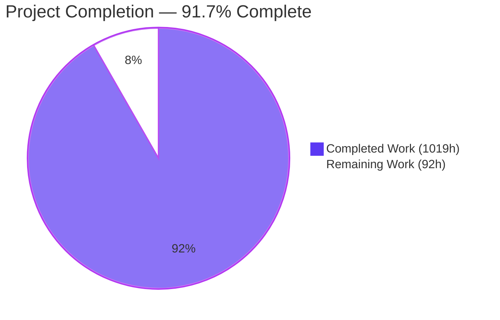
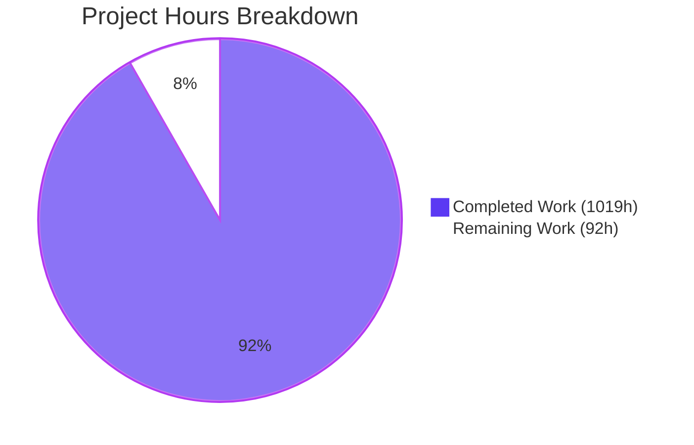
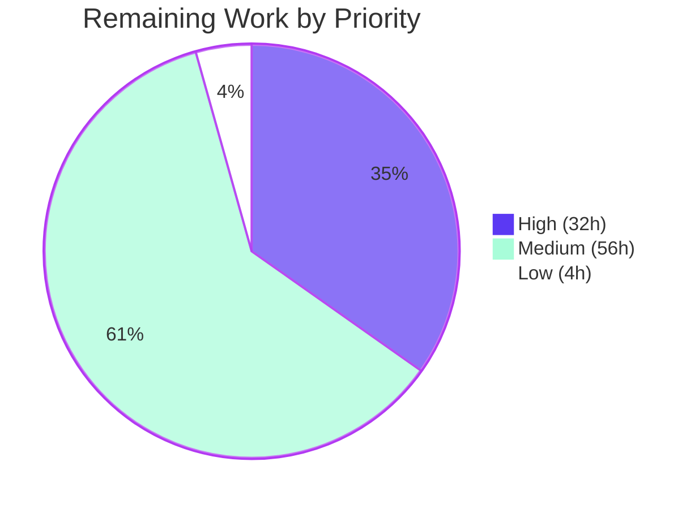

# 1. Executive Summary

## 1.1 Project Overview

This project adds a browser replacement for the legacy Epi Info 7 Enter data-entry module, built beside the desktop suite without changing it. A .NET 10 minimal API (`EpiInfo.Domain`, `EpiInfo.CheckCode`, `EpiInfo.Data`, `EpiInfo.Api`) reads Epi Info form metadata and records from an existing SQL Server project database. A React 18 + TypeScript client lets one local user list forms, render pages, navigate, search, create, edit and soft-delete records, with legacy check-code effects. Writes are now transactional and reads never write. The users are epidemiologists and data-entry staff who run Epi Info projects locally. The scope covers the API, the interpreter, the client, the automated test suites, a Docker image and a parity ledger (`docs/parity-notes.md`).

## 1.2 Completion Status



| Metric | Value |
|---|---|
| Total Hours | 1,111 |
| Completed Hours (Baseline: Human with agentic-assist) | 1,019 |
| Remaining Hours | 92 |
| Percent Complete | 91.7% (1,019 ÷ 1,111) |

## 1.3 Key Accomplishments

- ✅ The solution builds with 0 warnings. All 6,319 .NET tests and 1,113 client tests pass on the final commit.
- ✅ All 13 API endpoints serve both seeded forms, with RFC 7807 errors, write outcomes and redacted logs.
- ✅ Create, update and soft delete each run in one transaction and match the stored-data contract. Reads never write.
- ✅ The check-code interpreter passes all 24 in-scope scenarios, and its effects reach the screen (DOB → Age 25).
- ✅ The browser workflow works end to end: forms list, pages, navigator, grid search, Find, create, edit, delete.
- ✅ The API binds to loopback only, enforces Host, media-type and 1 MB body guards, and its OpenAPI document and client types are current.
- ✅ 5 of 6 deliverable P2 items are delivered: permission awareness, URL switches, SC-11 performance (2/2), a working Docker image and extra test coverage.
- ✅ `docs/parity-notes.md` records run results, the legacy defects kept, search semantics and every parity gap.

## 1.4 Critical Unresolved Issues

Against the AAP's 17 scoped deliverables (11 success criteria and 6 deliverable P2 items), 4 are open: 3 of 11 success criteria (SC-5, SC-6, SC-8) and 1 of 6 P2 items (the parity matrix). Two further P2 items, Relate fields and a SQLite store, were excluded by the AAP itself. Beyond those deliverables, 4 verification and hardening items remain open, so 6 rows are listed below.

| Issue | Impact | Owner | ETA |
|---|---|---|---|
| SC-5, SC-6 and SC-8 are recorded as failing on 4 P0 parity gaps: Find `[...]` sets over 4,000 characters, `nchar` padding, Legal Values options and repeated field names (Section 5.2) | No seeded form can reach them; forms in other projects can | Product owner + backend developer | 8 h |
| Parity matrix (P2) not written | The ledger has no feature-by-feature status table | Developer / technical writer | 12 h |
| The README clean-checkout sequence has not been rerun at SQL Server's default parallelism on the final commit | SC-1 evidence for the latest changes comes from runs at MAXDOP 1 | QA / DevOps | 6 h |
| No least-privilege SQL login is defined for the API | A principal that can write `meta*` tables could redirect reads and writes | DBA | 6 h |
| No automated test denies a write to a real restricted SQL principal | The 403 path is proven only through the in-memory test store | Backend developer | 8 h |
| Client follow-ups: a check-code ASSIGN is not shown on a focused number field, and a CLEAR after a create stores 0 instead of NULL for a dirty checkbox | The effect appears only after blur; a rare NULL/0 difference | Frontend developer | 10 h |

## 1.5 Access Issues

| System/Resource | Type of Access | Issue Description | Resolution Status | Owner |
|---|---|---|---|---|
| SQL Server logins | Credential | Only the published rehearsal `sa` login exists. No restricted login is available to test permission denial or to run production least-privilege. | Open (tasks in Section 2.2) | DBA |
| Docker bridge network → api.nuget.org | Network egress | On hosts whose uplink MTU is below 1500, `dotnet restore` in a bridge-networked build fails with NU1301 | Workaround: a TCP MSS clamp or `--network host` builds | DevOps |

## 1.6 Recommended Next Steps

1. [High] Decide whether to accept or fix each of the 4 P0 parity gaps, and update SC-5, SC-6 and SC-8 in `docs/parity-notes.md`.
2. [High] Rerun the README clean-checkout sequence through Compose, at SQL Server's default parallelism, on the final commit.
3. [High] Create a least-privilege SQL login for the API, and review and sign off the accepted divergences in Section 5.2.
4. [Medium] Add a restricted-principal permission test, and fix the number-field ASSIGN display.
5. [Medium] Set up CI that runs the whole build, test, lint, audit, e2e and Docker gate.

# 2. Project Hours Breakdown

## 2.1 Completed Work Detail

| Component | Hours | Description |
|---|---|---|
| Solution, build and tooling configuration | 16 | `EpiInfo.Web.sln` (8 projects), `global.json` 10.0.100 latestPatch, central package pins, nullable-as-error props, `appsettings*.json` exactly as specified, strict TS/eslint |
| `EpiInfo.Domain` | 90 | Field-type mapping, form definitions (page-bound fields in TabIndex order), typed values, two-phase validation with legacy messages, Find criteria parsing and query rules (44 files) |
| `EpiInfo.Data` | 130 | Metadata reader with object roles and fingerprint, transactional record repository (UPDLOCK, single stamp, write outcomes), list and Find SQL builders including packed binding and the long-pattern program, error classifier, identifier quoting, value converter, permission reader |
| `EpiInfo.Api` | 100 | 13 minimal-API endpoints, Form/Record/FieldEvent services, RFC 7807 and `writeOutcome` errors, loopback/Host/body/media-type guards, static client hosting, strict JSON, OpenAPI transformers and committed document, health check |
| OpenAPI generation and freshness scripts | 16 | `web/scripts/api-generate.mjs` and `check-api-fresh.mjs`, with mkdtemp output and a byte-compared generated client |
| Check-code interpreter (P1) | 70 | Hand-written lexer, recursive-descent parser and evaluator for the in-scope subset, YEARS/EPIWEEK ports, effect accumulator, diagnostics |
| Web UI components and styles | 110 | Forms list, form view with ARIA tabs, 10 field components, record grid, navigator, Find dialog, confirm/message dialogs, connection error, validation summary, accessibility and narrow layout |
| Web state, API client and client validation | 55 | `useRecordNavigation`, `useRecordEditor` (dirty set, save-before-leave, write-outcome retry), typed `openapi-fetch` client, error parsing, client validation |
| Client check-code events (P1) | 20 | `fieldEventQueue.ts` and `applyFieldEvent.ts`: capture, payload, apply, generation and drain |
| P2 permission awareness | 24 | `SqlPermissionReader`, `canInsert`/`canUpdate`/`canDelete` flags, 403 handling and UI gating |
| P2 URL switches, SC-11 performance and Docker image | 22 | `?view=&record=` deep links, `PerformanceTests` (p95 GET ≤ 300 ms, POST ≤ 500 ms), three-stage Dockerfile |
| .NET test suites | 170 | 6,319 xUnit tests across Domain, CheckCode, Data and Api, plus shared harness (`tests/Shared`: TestDatabase, DatabaseWriteLock, SqlSnapshot, ControlledTimeProvider) |
| Web test suites | 70 | 1,113 vitest tests in 6 files and the Playwright smoke spec with its support code |
| README and parity ledger | 46 | README web data-entry section (+114 lines) and `docs/parity-notes.md` (954 lines): Run results, Boundary checks, Assumptions, Legacy defects kept, Search semantics and Parity gaps sections |
| Integration hardening and runtime verification | 80 | Cross-module security and correctness hardening, whole-package gates, browser verification of every flow |
| **Total** | **1,019** | |

## 2.2 Remaining Work Detail

| Category | Hours | Priority |
|---|---|---|
| Decide on or close the 4 P0 parity gaps behind SC-5, SC-6 and SC-8, including a Legal Values NULL-option fix if parity is chosen | 8 | High |
| Rerun the README clean-checkout sequence through Compose at image-default parallelism on the final commit; tune if the packed Find query times out | 6 | High |
| Least-privilege SQL login and grants for the API (metadata trust anchor) | 6 | High |
| Code review of the 232-file change and sign-off on the accepted divergences in Section 5.2 | 12 | High |
| Parity matrix section of `docs/parity-notes.md` (P2) | 12 | Medium |
| Integration test against a real restricted SQL principal (403 on POST/PUT/DELETE, missing-page INSERT rule) | 8 | Medium |
| Client UI follow-ups: number-field ASSIGN display, field-event failure notice wording, CLEAR checkbox 0/NULL, modal scrollbar shift | 10 | Medium |
| Dev-toolchain upgrade past Vite/Vitest advisories (needs the AAP-pinned majors amended) | 8 | Medium |
| CI pipeline running the whole-package gate | 12 | Medium |
| Deployment configuration and operations: secret injection, container host networking, log collection, health probe | 6 | Medium |
| Committed test for the metadata column fallback decoder below compatibility level 130 | 4 | Low |
| **Total** | **92** | |

## 2.3 Hours Calculation

- Completed: 1,019 h, the sum of Section 2.1, all on AAP-scoped components.
- Remaining: 92 h, the sum of Section 2.2: High 32 h, Medium 56 h and Low 4 h.
- Total: 1,019 + 92 = 1,111 h.
- Completion: 1,019 ÷ 1,111 × 100 = **91.7%**.
- Confidence: high for the configuration, CI and test tasks. Medium for the P0 parity decision and the clean-checkout rerun, whose effort depends on whether the packed Find query needs tuning at default parallelism.

# 3. Test Results

All the results below came from runs on the final commit, against a freshly restored copy of the rehearsal database. Its nine `99_verify` checks all returned `ok = 1`, and the server ran SQL Server 2022 CU28.

| Area / Category | Framework | Tests | Passed | Failed | Coverage | What This Proves |
|---|---|---|---|---|---|---|
| Domain rules (`tests/EpiInfo.Domain.Tests`) | xUnit 2.9.3 | 1,274 | 1,274 | 0 | Not measured | Field-type mapping, form definitions, value coercion, two-phase validation and Find parsing follow the legacy rules |
| Check-code interpreter (`tests/EpiInfo.CheckCode.Tests`) | xUnit 2.9.3 | 1,051 | 1,051 | 0 | Not measured | The lexer, parser, evaluator, YEARS/EPIWEEK and diagnostics behave as specified for the supported subset |
| Data access on SQL Server (`tests/EpiInfo.Data.Tests`) | xUnit 2.9.3 | 808 | 808 | 0 | Not measured | Metadata reads, transactional writes, locks, Find and list SQL bounds, identifier quoting and error classification hold against a real server |
| API contract, hosting and end-to-end scenarios (`tests/EpiInfo.Api.Tests`) | xUnit + Mvc.Testing 10.0.15 | 3,186 | 3,186 | 0 | Not measured | Endpoints, ProblemDetails, write outcomes, guards, redaction, stored-data contract, read equivalence, transactional rollback and all 24 check-code scenarios behave as specified |
| SC-11 performance (`--filter Category=Performance`) | xUnit | 2 | 2 | 0 | n/a | p95 `GET …/records/at/{position}` stays within 300 ms and p95 `POST` save within 500 ms over 100 sequential calls |
| Client components, state and events (`web/src/**/*.test.ts(x)`) | Vitest 2.1 + jsdom + Testing Library | 1,113 | 1,113 | 0 | Not measured | The renderer, navigator, editor, save-before-leave, Find dialog, URL switches, permission gating and check-code effects behave as specified in the browser model |
| Browser smoke (`web/e2e/smoke.spec.ts`) | Playwright 1.65 Chromium | 1 | 1 | 0 | n/a | The served client lists forms, creates, edits, navigates, finds and deletes a record, with SQL readback, and check code assigns Age on screen |
| Static and supply-chain gates | `tsc --noEmit` + eslint, `check-api-fresh`, `npm audit --omit=dev`, `dotnet list package --vulnerable` | 4 checks | 4 | 0 | n/a | The client is strictly typed, the OpenAPI document and generated client are current, and there are 0 production npm and 0 NuGet vulnerabilities |

In total, 6,321 .NET tests (6,319 in the default run plus 2 performance tests) and 1,114 web tests pass, and none fail or are skipped.

**Not Covered**
- **Write denial by a real SQL principal.** Write denial (403 on POST, PUT or DELETE, and the rule for an INSERT on a missing page) is asserted only through the in-memory `FakeDataStore`. Before release, run it against a restricted login on a disposable database copy.
- **The metadata column fallback decoder below compatibility level 130** (`MetadataQueries.Columns`). The seeded database is at level 160. Test it on a database set to level 120.
- **Code coverage.** No percentage is measured, because the pinned toolchain deliberately has no coverage collector.
- **The README clean-checkout sequence through Docker Compose** at SQL Server's default parallelism (MAXDOP 0) on the final commit. Rerun it before release.
- **Playwright's self-started web-server mode** (fixed port 5000) and the Vite dev-server proxy (5173 to 5000). The smoke test ran against an already-running API through `E2E_BASE_URL`. Run `npm run e2e` once without it on a machine where port 5000 is free.
- **Forms outside the seeded project.** These may contain `nchar` columns, NULL code-table rows or repeated field names. Unit tests pin the recorded behaviour, but no seeded form exercises it end to end.

# 4. Runtime Validation & UI Verification

The flows below were driven against the API running from the final build on a loopback port, with the built client served at `/`, in headless Chrome and with direct HTTP calls. By design there is no login, because the app runs in local single-user mode.

- ✅ **Start-up and health:** `/health` returns 200 within about 2 s. With no connection string the API logs a warning and answers 503, and a `0.0.0.0` bind aborts start-up ("must bind to http://127.0.0.1 only").
- ✅ **Forms and definitions:** both forms are listed (CaseReport 1 page with 61 fields; FoodHistory 2 pages with 55 + 33). GEOCODE is flagged as unsupported check code, and Yes/No fields render as "Unsupported field type".
- ✅ **Navigation:** 8 of 8 browser checks passed. First, Previous, Next, Last and go-to work, and "n of N" matches the API (699 and 1,425). Tab switches send no request, record loads send only GETs, and the console shows 0 errors.
- ✅ **Grid search and Show deleted:** a search for "Moore" returns 3 rows, and turning Show deleted on and off moves the total between the active and all-records counts.
- ✅ **Create, edit, Find, delete:** 9 of 9 browser checks passed. POST returns 201 and PUT 200, the PUT carrying only the changed field. Find returns the marker and leaves the open record out by design. A confirmed DELETE returns 204, and the deleted record is read-only while Show deleted is on.
- ✅ **Check-code field events:** leaving DOB (01-01-1986, interview date 05-11-2011) assigns Age 25, both on screen and through `POST /api/forms/2/checkcode/field-event`.
- ✅ **Validation and errors:**
  - Age "abc" is blocked in the client, and save-before-leave holds the user on the record.
  - The server answers 400 with field errors, 415 for `text/plain`, 404 ProblemDetails with a traceId, and 400 for a foreign Host.
- ✅ **URL switches, 375 px layout and keyboard:** `?view=&record=` deep links open the right record, and form names are matched case-insensitively. The page does not overflow at 375 px, and a focus ring is visible.
- ✅ **Docker image:** built with BuildKit and run as user `app` (1654) with `--network host`. `/health`, `/` and `/api/forms` return 200.
- ⚠ **Permission awareness:** the flags are all true for the rehearsal login, and New, Save and Delete follow them. A denial was checked only once by hand, on a disposable database copy under a restricted principal, where POST, PUT and DELETE each returned 403.

These were never exercised at runtime:
- the Vite dev server;
- the Compose clean-checkout path at default parallelism on the final commit;
- a Docker build on a bridge network;
- any deployment beyond a single Linux host.

# 5. Compliance & Quality Review

## 5.1 Compliance Matrix

| AAP Deliverable | Benchmark | Status | Progress |
|---|---|---|---|
| SC-1: build and clean checkout | Solution builds with 0 warnings; documented commands exit 0; `/health` 200 | ⚠ Passes at MAXDOP 1 on the final commit; Compose rerun at default parallelism pending | 🟪🟪🟪🟪⬜ 90% |
| SC-2: browser workflow | Playwright smoke with SQL readback and a clean-load check | ✅ Pass (1/1) | 🟪🟪🟪🟪🟪 100% |
| SC-3 and SC-7: stored-data contract and transactional save | Row-level contract; rollback on a page-insert timeout | ✅ Pass | 🟪🟪🟪🟪🟪 100% |
| SC-4: read equivalence (`DATA-01`) | API values equal SQL for every record; reads issue only SELECT | ✅ Pass | 🟪🟪🟪🟪🟪 100% |
| SC-5: navigation, listing and Find | Legacy Find semantics, positions, deleted toggle | ⚠ All tests pass; recorded as failing on 1 P0 parity gap | 🟪🟪🟪🟪⬜ 95% |
| SC-6: validation and save gate | Field and request errors, required wording, nothing written on rejection | ⚠ All tests pass; recorded as failing on 1 P0 parity gap (`nchar`) | 🟪🟪🟪🟪⬜ 95% |
| SC-8: metadata mapping and renderer | Page-bound fields in TabIndex order; C-7 field-count totals (43/43 and 74/67); accessible structure | ⚠ All tests pass; recorded as failing on 2 P0 parity gaps | 🟪🟪🟪🟪⬜ 90% |
| SC-9 and SC-10: check code (P1) | 24 in-scope scenarios; effects reach the screen | ✅ Pass | 🟪🟪🟪🟪🟪 100% |
| Security constraints (AAP 0.7.6, 0.9.3) | Loopback-only bind, Host guard, 415/413 guards, parameterized SQL, quoted identifiers, redacted errors and logs, no committed secrets | ✅ Pass | 🟪🟪🟪🟪🟪 100% |
| Dependency and file-map discipline (0.4.1, 0.5) | Exact pins; forbidden packages absent; only mapped paths added; legacy code and `testdata/` untouched | ✅ Pass (one unlisted npm override) | 🟪🟪🟪🟪🟪 100% |
| P2 items (0.2.4) | Permissions, URL switches, SC-11, parity matrix, Docker, extra coverage | ⚠ 5 of 6 delivered; parity matrix not written | 🟪🟪🟪🟪⬜ 85% |
| README and parity ledger (0.7.3, 0.9.4) | README section; ledger sections from Run results to Parity matrix | ⚠ All present; the Parity matrix section reads "Not delivered (P2)" | 🟪🟪🟪🟪⬜ 90% |

## 5.2 AAP & Rule Divergences and Gaps

No user Rules were supplied, so every row below is measured against the AAP.

| What the AAP/Rule Required | What Was Delivered Instead | Why It Diverged | Impact | Remediation |
|---|---|---|---|---|
| SC-5 (0.3.4.4): Find patterns keep legacy `LIKE` meaning | A pattern holding a `[...]` set longer than 4,000 characters that is unclosed, or that cannot be cut, answers 400 (`src/EpiInfo.Domain/Search/SearchCriteriaParser.cs:835`). SC-5 is recorded as failing | SQL Server refuses `nvarchar` patterns over 4,000 code units (error 8152), and an unclosed set has no meaning that holds across collations | No seeded value is affected; a user gets a field error | Accept the limit in writing, or define an alternative; update the SC-5 row |
| SC-6 / `DATA-01`: values round-trip as legacy reads them | Short text on an `nchar(n)` column is stored and read back padded, so a saved short legal choice reads back as a non-option (`src/EpiInfo.Data/Sql/ColumnValueConverter.cs`) | SQL Server pads `nchar`; trimming on read would break read equivalence | No seeded column is `nchar` | Accept, or compare trimmed in Legal Values validation |
| SC-8 (0.3.4.3): Legal Values options as legacy shows them | A NULL code-table row is not offered, and texts the culture ranks equal are ordered ordinally (`src/EpiInfo.Data/Metadata/SqlMetadataReader.cs`) | An option's value and label are both its stored text, and NULL has none | An empty field still saves NULL; no seeded field is affected | Accept, or add an explicit empty option |
| SC-8: repeated field names handled as legacy does (first by control position, later repeats omitted ignoring case) | Later exact repeats are listed `unsupported`, and case variants stay distinct fields (`src/EpiInfo.Domain/Metadata/FormDefinitionFactory.cs`, `DataFieldSet`) | C-7 requires every `metaFields` row to be listed; keys are ordinal; control positions are not read | No seeded form has a repeat | Accept, or port the legacy rule |
| 0.2.4: "P2 work starts once every P0 criterion passes" | Permissions, URL switches, SC-11 and Docker were delivered while SC-5, SC-6 and SC-8 are recorded as failing | Delivery took the file map's P2 files as in scope, on the recorded basis that a lower tier's open gap does not block a higher tier | No P0 regression (all tests pass); more code to review | Sign off, or defer the P2 code |
| 0.2.4 / 0.9.4: Parity matrix section (P2) | "Not delivered (P2)" (`docs/parity-notes.md:952-954`) | Held back under the same P2 start rule, because its statuses depend on the failing P0 criteria | No feature-by-feature status table | Write the matrix |
| 0.2.4: Relate fields, child forms and SQLite store | Not delivered; listed under Undelivered items | **Sanctioned:** the AAP itself places both outside this run | None | None needed |
| 0.3.4.4: grid `q` as `LIKE @q COLLATE Latin1_General_100_CI_AS ESCAPE` | A `q` whose escaped pattern exceeds 4,000 units runs a long-pattern program of `PATINDEX` prefixes plus collation equality (`src/EpiInfo.Data/Records/SearchSqlBuilder.cs`, "Long patterns") | Error 8152 makes a single `LIKE` impossible | Same rows returned; about 3.5 s for a very long `q`; seek limited to 33 prefixes | Sign off |
| 0.3.4.6: every Find value bound as its own parameter | More than 2,000 alternatives are packed into `nvarchar(max)` lists decoded in SQL (`SearchSqlBuilder.cs:147`, `ScalarParameterBudget = 2000`) | SQL Server's limit of 2,100 parameters per statement | Still parameterized; the packed query is CPU-heavy and sensitive to parallelism | Sign off; recheck at default MAXDOP |
| 0.3.4.1: `includeDeleted`, `page` and `pageSize` "bound as a string" | Bound as `string[]?` (`src/EpiInfo.Api/Endpoints/RecordEndpoints.cs:180-182`); OpenAPI still publishes a scalar | So that repeated query parameters are rejected with 400 rather than one being picked | Same for single values; stricter on repeats | Sign off |
| 0.5.3: `api:generate` steps | Adds `-p:_OpenApiDocumentsCache=<temp marker>` (`web/scripts/api-generate.mjs:245`) | Keeps generation inside its own temp directory and safe beside concurrent builds | Byte-identical output; freshness check passes | Sign off |
| 0.7.3: `SQL_HOST=<host,port> MSSQL_SA_PASSWORD=<password> bash testdata/init.sh` | Exported `SQL_HOST` plus a prompted password (`README.md:79-83`) | `<…>` placeholders parse as shell redirection, so the literal line is not runnable; the prompt keeps the password out of shell history | None; the verbatim Compose block is unchanged | Sign off |
| 0.2.4: `docker run … -e ConnectionStrings__EpiInfo=<value>` | `-e ConnectionStrings__EpiInfo` passed by name after an export (`README.md:134`; Dockerfile header) | The same placeholder problem; keeps the credential off the command line | None | Sign off |
| 0.2.4: three-stage Dockerfile | Also requires BuildKit and a git-checkout build context, and takes the settings files from HEAD (`src/EpiInfo.Api/Dockerfile:12-18`) | No `.dockerignore` may be added (C-13), so the stages bind-mount and read only tracked sources | Tarball and worktree contexts fail with a clear error | Note in the deployment runbook |
| 0.5.3: scripts write into `mkdtemp` directories | Directories are checked immediately before each operation, which leaves a small check-to-use window (`web/scripts/*.mjs`) | Node's `fs` has no descriptor-relative (`openat`) calls | Affects local developer tooling only | Sign off |
| 0.3.6: CLEAR empties the field | A CLEAR after a POST or PUT has sent `false` for a still-null dirty checkbox saves 0, not NULL (`web/src/state/useRecordEditor.ts:928`) | The field-event answer gives the editor no trusted list of cleared names at that point; accepted as a known issue | A rare NULL/0 difference | Decide, then fix |
| 0.3.6: check-code effects appear on screen | ASSIGN or CLEAR on the focused number field is not shown until blur (`web/src/components/fields/NumberInput.tsx:102-108`) | The render-time draft sync keeps the typed draft; not implemented in this run | Display lag (reproduced 3 of 3 times) | Fix |
| 0.3.4.2 / 0.3.6: field-event failures explained clearly | An event carrying a raw invalid value (Age "abc") answers 400, and the notice does not name the cause | Not implemented in this run | A confusing notice | Fix the wording |
| 0.3.6: modal dialogs | The page shifts about 7.5 px when a modal opens on a page shorter than the viewport (`web/src/styles.css`) | A pre-existing scrollbar-gutter behaviour; not implemented in this run | Cosmetic | Fix |
| 0.3.5: `=` on two texts compares as legacy does (desktop culture, NLS) | Invariant-culture linguistic comparison, ignoring case (`src/EpiInfo.CheckCode/Evaluation/ValueComparer.cs`) | The server can run neither the desktop culture nor NLS | `ß`/`ss` and the Turkish `i` differ; no seeded program is affected | Sign off |
| 0.3.5: `=` on numeric text (desktop culture) | Parsed in the invariant culture | The server cannot know the desktop culture | `"1,5"` reads as 15, not 1.5 (de-DE); no seeded program is affected | Sign off |
| 0.3.5: `=` with an unconvertible boolean on the left (legacy throws and leaves the block) | One `error` diagnostic; the statement is skipped and later statements run (`Evaluator.cs`) | A field event has no counterpart for an exception that ends the block | No seeded program is affected | Sign off |
| 0.3.5: `=` between a date and text (desktop date format) | Compared through the invariant form, such as `01/15/2011 00:00:00` | The desktop's date format is unknown to the server | No seeded program is affected | Sign off |
| 0.3.5: `EPIWEEK` reads date text as legacy does | Two date families are parsed in the invariant culture (`src/EpiInfo.CheckCode/Functions/EpiWeekFunction.cs`) | Legacy's reading depends on culture, clock and time zone, which no deterministic port can match | The seeded call passes a Date field | Sign off |
| 0.3.5: a condition with no value (legacy throws) | `A condition has no value.` error diagnostic; neither branch runs | The same diagnostic model as above | No seeded program is affected | Sign off |
| 0.2.4 P2 permissions proven against SQL Server | Denial is proven only through `FakeDataStore`, plus one manual check on a disposable copy (`src/EpiInfo.Data/Permissions/SqlPermissionReader.cs`) | A denied principal needs a new login, which the unchanged-database rule (0.9.1) excludes | The 403 path has no regression test against real SQL | Add a restricted-login test |
| 0.7.3 / SC-1: the clean-checkout sequence passes on the delivered tree | Last run at Compose defaults was on an earlier tree (6,253 tests). Later changes were checked at MAXDOP 1 (`docs/parity-notes.md:48`) | The later changes were verified on a host where port 1433 was already in use, so the Compose service could not start; the packed Find case is sensitive to parallelism | Possible timeout at default MAXDOP | Rerun on a dedicated host |
| 0.5.2: the listed npm dependencies | `overrides` pins `eslint-visitor-keys ^4.2.1` under `@typescript-eslint/visitor-keys` (`web/package.json:40-44`) | The reason is not recorded | None observed; lint passes | Confirm or remove |
| 0.3.4.5: required gate as specified | The server also enforces required on checkbox and option fields, where the client and legacy do not (`src/EpiInfo.Domain/Validation/RecordValidator.cs`) | Not changed in this run | A save the client allows can get a 400 | Decide the intended rule |
| 0.3.4.7: static client served safely | The client folder is refused when world-writable, but group write is allowed and ancestors, owner and Windows ACLs are not checked (`src/EpiInfo.Api/Hosting/ClientAppHosting.cs:63`) | Default umask 002 makes build output group-writable; .NET exposes no file owner; ACLs could not be tested | A shared-group account could alter the served client | Sign off, or harden for multi-user hosts |
| 0.3.4.4: grid `q` of any length is a literal contains | A very long percent-encoded `q` hits Kestrel's 8 KB request-line limit and gets 414 | Kestrel's default limit was kept | Extreme `q` lengths cannot be sent | Sign off |

**Find sets over 4,000 characters (SC-5).** Legacy silently shortened such patterns, and SQL Server cannot evaluate them whole. The delivered code rejects only the unclosed or uncuttable case, with a named field error (`SearchCriteriaParser.cs:835`). The pinning tests are `SearchCriteriaParserTests.Limits_PatternWithAnUnsearchableSet_IsAFieldError` and `ListAndSearchBoundsTests.Search_UnsearchableSet_IsA400BeforeTheStore`. The product owner should decide whether this limit is acceptable. If it is, record SC-5 as passing with a documented limit in `docs/parity-notes.md`. If not, specify the behaviour required.

**`nchar` padding (SC-6).** On an `nchar(n)` column, values that differ only in trailing spaces store as one value, and a short legal choice reads back padded, so resubmitting it verbatim gets a 400. Trimming on read would break SC-4's read equivalence. The behaviour is pinned by `RecordValidatorTests.ValidateInput_PaddedReadBackOfAShortNcharOption_IsNotALegalValue`. No seeded column is `nchar`, but other projects may have one. Choose between accepting the behaviour and comparing trimmed values in Legal Values validation only (about 4 h).

**Legal Values options (SC-8).** The legacy combo box shows a NULL code-table row as an empty item. The delivered reader drops it, because the option's value and label are its stored text (`SqlMetadataReader.cs`, pinned by `SqlMetadataReaderToOptionsTests`). Leaving the field empty still saves NULL, so the data written is unchanged. Only the displayed list differs. Adding an explicit empty option would close the visible gap. The remaining ordering difference applies only to texts the culture ranks equal.

**Repeated field names (SC-8).** C-7 requires every `metaFields` row to be listed, so a repeated name appears as an `unsupported` row instead of being omitted as legacy omits it. Case variants also stay as separate fields. This is pinned by `FormDefinitionFactoryTests.Create_RowRepeatingADataFieldNameExactly_IsListedUnsupportedAndOnlyTheFirstHoldsTheName`. A direct SQL check finds no repeat in the rehearsal database. Run the same query (`docs/parity-notes.md:910`) against production projects, then accept the gap or port the legacy rule.

**P2 delivered before P0 passed, and the matrix withheld.** The AAP orders P2 work after every P0 criterion passes. Four P2 items shipped while SC-5, SC-6 and SC-8 were still recorded as failing, but the parity matrix was held back under that same rule (`docs/parity-notes.md:952-954`). The P2 code passes its tests (`PermissionTests` 54, `App.test.tsx` 53, Performance 2/2, and a verified Docker run). The owner should confirm the P2 code is wanted now and commission the matrix (12 h).

**Permission denial against a real principal.** The permission rule is ported and checked inside every write transaction (`SqlRecordRepository.ReadPermissionsInTransactionAsync`). However, the automated suite proves denial only through `FakeDataStore`, because the rehearsal database cannot gain a restricted login. One manual check on a disposable copy returned 403 for POST, PUT and DELETE. Add an Integration test that creates a temporary restricted user on a throwaway database (8 h).

**Clean checkout at default parallelism.** SC-1 last passed through Compose at SQL Server's image defaults (MAXDOP 0) on an earlier tree. Every later change was verified at MAXDOP 1. On an earlier tree at those defaults, the packed `GlobalRecordId` Find case also once exceeded its 30 s timeout. Rerun the README sequence on a dedicated host on the final commit. Production servers left at MAXDOP 0 need the same check (6 h).

# 6. Risk Assessment

| Risk | Category | Severity | Probability | Mitigation | Status |
|---|---|---|---|---|---|
| Forms outside the rehearsal project hit the recorded P0 parity edge cases: `nchar` columns, NULL code-table rows, repeated field names, or Find sets over 4,000 characters | Technical | Medium | Low | Run the ledger's detection queries against production projects; decide or fix the gaps behind SC-5, SC-6 and SC-8 | Open |
| Query plans change at SQL Server's default parallelism (MAXDOP 0, cost threshold 5); the packed `GlobalRecordId` Find case once exceeded its 30 s timeout there | Technical / Operational | Medium | Medium | Rerun the clean-checkout sequence at the defaults; set MAXDOP 1 or tune the packed decode if it times out; `Database:CommandTimeoutSeconds` is configurable | Open |
| No authentication: anyone with local access to the loopback port can read and write every record | Security | High | Low | Keep the loopback-only bind and Host guard (non-loopback binds abort start-up); never publish the port; add authentication before any multi-user deployment | Accepted by design |
| The API trusts metadata tables to name the record tables; a principal that can write `meta*` tables could redirect reads and writes | Security | High | Medium | Run the API under a least-privilege login: SELECT on `meta*`, code and form tables, INSERT/UPDATE only on base and page tables, never `sa` | Open |
| Dev-toolchain advisories: vitest and tinypool critical, vite high, plus 3 moderate (6 in total); production dependencies have none | Security | Medium | Low | Never expose the Vite or Vitest UI servers; upgrade to Vite ≥ 6.4.4 and a current Vitest once the pinned majors are amended | Open |
| Write denial has not been exercised against a real restricted SQL principal | Integration | Medium | Low | Add an Integration test with a temporary restricted user on a throwaway database | Open |
| Concurrent saves can deadlock: a list read beside a create, or interdependent updates, answers 503 `notWritten`, and Find admits 2 statements at a time, queueing the rest | Operational | Low | Medium | The client offers Retry for `notWritten`. Monitor the 503 rate in the JSON logs; widen the Find admission only after load testing | Accepted |
| The Docker build needs BuildKit and a git-checkout context, and the runtime relies on Linux host networking | Operational / Integration | Medium | Medium | Document the build context and `--network host` in the deployment runbook; build in CI from a clean checkout | Open |

# 7. Visual Project Status



**Remaining hours by priority** (92 h in total)



| Remaining category (Section 2.2) | Hours | Priority |
|---|---|---|
| Code review and divergence sign-off | 12 | High |
| Parity matrix section | 12 | Medium |
| CI pipeline for the whole-package gate | 12 | Medium |
| Client UI follow-ups | 10 | Medium |
| P0 parity-gap decision and Legal Values fix | 8 | High |
| Restricted-principal permission test | 8 | Medium |
| Dev-toolchain upgrade | 8 | Medium |
| Clean-checkout rerun at default parallelism | 6 | High |
| Least-privilege SQL login | 6 | High |
| Deployment configuration and operations | 6 | Medium |
| Metadata fallback-decoder test | 4 | Low |
| **Total** | **92** | |

# 8. Summary & Recommendations

The Epi Info web data-entry system is **91.7% complete**: 1,019 of 1,111 hours are delivered, and 92 hours remain. The project adds 232 files (+175,366 lines) beside the legacy desktop suite and changes none of its files, apart from additions to `README.md`. A .NET 10 API in four projects serves 13 endpoints over the existing SQL Server project database. A React 18 client covers the full Enter workflow: listing forms, rendering pages, navigating, grid search, Find, and create, edit and soft delete with confirmation. The check-code interpreter runs the supported subset and shows its effects on screen.

On the final commit, the solution builds with 0 warnings. All 6,319 .NET tests, the 2 performance tests, 1,113 client tests and the Playwright smoke test pass. Lint and the OpenAPI freshness check pass, and there are 0 production npm and 0 NuGet vulnerabilities. A headless browser drove every primary flow without a console error, and the Docker image builds and serves the app. Writes are transactional and match the legacy stored-data contract, reads never write, and the API refuses any bind other than loopback.

The remaining gaps are mostly decisions, not unbuilt code. Four P0 parity gaps keep SC-5, SC-6 and SC-8 recorded as failing: Find sets over 4,000 characters, `nchar` padding, Legal Values options and repeated field names. All their tests pass, and no seeded form reaches them. Several items are also still open:
- the parity matrix (P2) is unwritten;
- write denial has no automated test against a real restricted principal;
- the clean-checkout sequence still needs a rerun at SQL Server's default parallelism on the final commit.

Section 5.2 documents 31 divergences, and most need only sign-off.

The critical path to production is the four High-priority items, 32 h in total:
1. the P0 gap decisions and the ledger update (8 h);
2. the clean-checkout rerun at default parallelism (6 h);
3. a least-privilege SQL login (6 h);
4. code review and divergence sign-off (12 h).

The Medium items follow: the parity matrix, the restricted-principal test, the UI follow-ups, the toolchain upgrade, CI and deployment configuration.

**Readiness:** the system is ready today for local single-user pilot use against rehearsal and project copies. Before production use on live project databases, require:
- SC-1 to pass at the target server's parallelism settings;
- the least-privilege login to be in place;
- the P0 parity decisions to be recorded;
- CI to run the whole-package gate on every change.

Then track these success metrics:
- the 6,319 + 1,113 test baseline stays green;
- SC-11 p95 stays at or under 300 ms (GET) and 500 ms (POST);
- the 503 rate in the JSON logs stays near zero;
- `npm audit --omit=dev` stays at 0.

# 9. Development Guide

Run every command from the repository root unless a step changes into `web/`. Always name `EpiInfo.Web.sln`: the root also holds `Epi Info 7.sln`, so a bare `dotnet build` fails with `MSB1011: Specify which project or solution file to use`.

## 9.1 System Prerequisites

- **.NET SDK 10.0.1xx.** `global.json` pins 10.0.100 with `latestPatch` and no prerelease; 10.0.115 was used here. A machine holding only a 10.0.4xx SDK is rejected.
- **Node.js 22.x** (≥ 22.12) with npm 11; `web/package.json` sets `engines.node` to `>=22 <23`.
- **SQL Server 2022.** Use either Docker Engine with Compose v2, which runs the rehearsal server in `testdata/`, or any reachable SQL Server 2022 plus `sqlcmd` 18 on `PATH`.
- **Playwright Chromium** (Linux): run `npx playwright install-deps chromium` once in `web/` after `npm ci`.
- **Optional for the image:** Docker with BuildKit, the default builder since Engine 23.
- **Hardware:** about 4 GB RAM for SQL Server, and about 2 GB of disk for SDK caches and build output.

## 9.2 Environment Setup

| Variable | Purpose | Example |
|---|---|---|
| `ConnectionStrings__EpiInfo` | Database for the API and both test harnesses; never committed | `Server=127.0.0.1,1433;Database=EpiRehearsal;User Id=sa;Password=Rehearsal!Passw0rd;TrustServerCertificate=True` |
| `SQL_HOST`, `MSSQL_SA_PASSWORD` | Fallback test connection and `testdata/init.sh` target | `127.0.0.1,1433`, `Rehearsal!Passw0rd` (rehearsal development value) |
| `Kestrel__Endpoints__Http__Url` | Listen URL; must be `http://127.0.0.1:<port>` | `http://127.0.0.1:5000` (default) |
| `Database__CommandTimeoutSeconds` | SQL command timeout | `30` (default) |
| `Web__ClientPath` | Built client folder | `../../web/dist` (default), `/app/client` in the image |
| `E2E_BASE_URL` | URL of a running API for Playwright | `http://127.0.0.1:5000` |

```bash
export DOTNET_CLI_TELEMETRY_OPTOUT=1 DOTNET_NOLOGO=1 CI=true
export MSSQL_SA_PASSWORD='Rehearsal!Passw0rd'          # development value from testdata/README.md
export SQL_HOST='127.0.0.1,1433'
export ConnectionStrings__EpiInfo='Server=127.0.0.1,1433;Database=EpiRehearsal;User Id=sa;Password=Rehearsal!Passw0rd;TrustServerCertificate=True'
```

## 9.3 Rehearsal Database

The Compose path follows the README. `db-init` drops and recreates `EpiRehearsal`, so point it only at the rehearsal server.

```bash
cd testdata
docker compose up -d --wait sqlserver
docker compose run --rm db-init
cd ..
```

Alternatively, use an existing server:

```bash
bash testdata/init.sh
```

Then confirm the precondition, which requires all nine rows to show `ok = 1`:

```bash
sed '/^USE /d' testdata/sql/99_verify.sql | sqlcmd -C -b -S 127.0.0.1,1433 -U sa -P "$MSSQL_SA_PASSWORD" -d EpiRehearsal -W -s '|' -i /dev/stdin
```

Expected checks:

| Check | Expected |
|---|---|
| `metaViews` | 2 |
| `metaPages` | 3 |
| `metaFieldTypes` | 28 |
| `CaseReport records` | 1409 |
| `FoodHistory records` | 609 |
| each orphan check | 0 |
| `soft-deleted records` | 29 |

Test runs leave `T-<guid>` marker records, so re-initialise the database before a full rerun.

## 9.4 Build and Test

```bash
dotnet build EpiInfo.Web.sln                      # expect: 0 Warning(s), 0 Error(s)
dotnet test EpiInfo.Web.sln --no-build            # expect: 6,319 passed (Domain 1,274, CheckCode 1,051, Data 808, Api 3,186), ~4-5 min
dotnet test tests/EpiInfo.Api.Tests --no-build --filter Category=Performance   # run alone; expect 2 passed
dotnet list EpiInfo.Web.sln package --vulnerable --include-transitive          # expect: no vulnerable packages
```

Narrower runs (any explicit `--filter` replaces the default `Category!=Performance`):

```bash
dotnet test EpiInfo.Web.sln --no-build --filter "Category!=Integration"        # no database needed
dotnet test tests/EpiInfo.Domain.Tests/EpiInfo.Domain.Tests.csproj --no-build --filter "Category!=Integration"   # 1,274 passed
dotnet test tests/EpiInfo.CheckCode.Tests/EpiInfo.CheckCode.Tests.csproj --no-build --filter "FullyQualifiedName~LexerTests"   # 270 passed
```

Client steps. Run lint after the .NET build, never at the same time, because the freshness check builds the API:

```bash
cd web
npm ci
npm run build          # tsc --noEmit, then 62 modules into web/dist
npm test               # expect: 6 files, 1,113 passed
npm run lint           # expect: "OpenAPI document and generated client are current."
npm audit --omit=dev   # expect: found 0 vulnerabilities
```

## 9.5 Application Startup

```bash
(cd web && npm ci && npm run build)
dotnet run --project src/EpiInfo.Api --no-launch-profile
```

The API serves the client and the HTTP API at `http://127.0.0.1:5000`. To use another loopback port, prefix `Kestrel__Endpoints__Http__Url=http://127.0.0.1:5080`. The API loads the built client once at start-up, so restart it after `npm run build`. For client development, run `npm run dev` in `web/`: Vite serves port 5173 and proxies `/api` and `/health` to `127.0.0.1:5000`.

## 9.6 Verification

```bash
curl -s http://127.0.0.1:5000/health                   # {"status":"healthy"}
curl -s http://127.0.0.1:5000/api/forms                # CaseReport (viewId 1, 1 page), FoodHistory (viewId 2, 2 pages)
curl -s -o /dev/null -w '%{http_code}\n' http://127.0.0.1:5000/   # 200, the built index.html
cd web && E2E_BASE_URL=http://127.0.0.1:5000 npm run e2e          # expect: 1 passed
```

Open `http://127.0.0.1:5000/` in a browser. The first screen is the forms list, and there is no login.

## 9.7 Example Usage

```bash
curl -s "http://127.0.0.1:5000/api/forms/1/records/count?includeDeleted=true"    # {"count":<n>}
curl -s "http://127.0.0.1:5000/api/forms/1/records?page=1&pageSize=2"            # {"items":[...],"total":<n>}
curl -s  http://127.0.0.1:5000/api/forms/2/records/at/1                          # first active FoodHistory record
curl -s -X POST http://127.0.0.1:5000/api/forms/2/records/search \
  -H 'Content-Type: application/json' \
  -d '{"criteria":[{"field":"LastName","value":"Moore"}]}'                      # total 3 on a fresh database
curl -s -X POST http://127.0.0.1:5000/api/forms/2/checkcode/field-event \
  -H 'Content-Type: application/json' \
  -d '{"event":"FieldAfter","fieldName":"DOB","values":{"DOB":"1986-01-01","DateofInterview":"2011-05-11"}}'   # "assigned":{"Age":25}
```

## 9.8 Docker Image (optional)

```bash
docker build -f src/EpiInfo.Api/Dockerfile -t epiinfo-web .
docker run --rm --network host -e ConnectionStrings__EpiInfo epiinfo-web
```

Build from the root of a git checkout. The image keeps the `127.0.0.1` binding, so it needs Linux host networking, and it runs as user `app` (1654).

## 9.9 Troubleshooting

| Symptom | Cause | Resolution |
|---|---|---|
| `MSB1011: Specify which project or solution file to use` | Bare `dotnet build` at the root | Use `dotnet build EpiInfo.Web.sln` |
| `/health` returns 503 `{"status":"unhealthy"}`; log says "ConnectionStrings:EpiInfo is not set" | No connection string | Export `ConnectionStrings__EpiInfo` and restart |
| Start-up aborts: "Listen setting 'urls' is not allowed: the API must bind to http://127.0.0.1 only" | `ASPNETCORE_URLS` or a non-loopback URL is set | Unset it; use `Kestrel__Endpoints__Http__Url=http://127.0.0.1:<port>` |
| 400 on every request from another host name | The Host guard accepts only loopback names | Browse `127.0.0.1` or `localhost` |
| 415 on POST/PUT | Body not sent as `application/json` | Set `Content-Type: application/json` |
| `sqlcmd` "TCP Provider: Error code 0x2749" | `localhost` resolves to `::1` with IPv6 disabled | Use `-C -S 127.0.0.1,1433` |
| `SearchStatementBoundsTests` packed case times out | Server at MAXDOP 0 with cost threshold 5, or a contended host | Rerun the class alone; set MAXDOP 1 / cost threshold 50 on the rehearsal server |
| Performance p95 over threshold with a normal p50 | Disk I/O contention on the log fsync | Check `/proc/pressure/io`; rerun alone on a quiet host |
| Docker `dotnet restore` fails with NU1301 | Bridge-network MTU larger than the host uplink | Build on a host with matching MTU, or add a TCP MSS clamp rule |
| e2e spec refuses to run against an existing API | `E2E_BASE_URL` set without a matching connection string | Export `ConnectionStrings__EpiInfo` for the same database the API uses |

# 10. Appendices

## A. Command Reference

| Purpose | Command |
|---|---|
| Build | `dotnet build EpiInfo.Web.sln` |
| All .NET tests (Performance excluded) | `dotnet test EpiInfo.Web.sln` |
| Tests without a database | `dotnet test EpiInfo.Web.sln --filter "Category!=Integration"` |
| Integration tests only | `dotnet test EpiInfo.Web.sln --filter "Category=Integration&Category!=Performance"` |
| SC-11 performance | `dotnet test tests/EpiInfo.Api.Tests --filter Category=Performance` |
| NuGet vulnerability check | `dotnet list EpiInfo.Web.sln package --vulnerable --include-transitive` |
| Client install, build, test | `cd web && npm ci && npm run build && npm test` |
| Lint + OpenAPI freshness | `cd web && npm run lint` |
| Regenerate OpenAPI document and client types | `cd web && npm run api:generate` |
| Browser smoke | `cd web && E2E_BASE_URL=http://127.0.0.1:5000 npm run e2e` |
| Production dependency audit | `cd web && npm audit --omit=dev` |
| Run the app | `dotnet run --project src/EpiInfo.Api --no-launch-profile` |
| Client dev server | `cd web && npm run dev` |
| Docker image | `docker build -f src/EpiInfo.Api/Dockerfile -t epiinfo-web .` |

## B. Port Reference

| Port | Service | Notes |
|---|---|---|
| 5000 | API and served client | `127.0.0.1` only; set with `Kestrel__Endpoints__Http__Url` |
| 5173 | Vite dev server | Loopback only; proxies `/api` and `/health` to `127.0.0.1:5000` |
| 1433 | SQL Server (Compose `sqlserver`) | Published on every host interface by `testdata/docker-compose.yml` |

## C. Key File Locations

| Path | Contents |
|---|---|
| `EpiInfo.Web.sln`, `global.json`, `Directory.Packages.props` | Solution, SDK pin, central NuGet versions |
| `src/EpiInfo.Api/Program.cs` | Composition root, guards, endpoint mapping |
| `src/EpiInfo.Api/Endpoints/` | Forms, records, check-code and health endpoints |
| `src/EpiInfo.Api/Hosting/` | Loopback, Host, body-limit and media-type guards; client hosting |
| `src/EpiInfo.Api/openapi/EpiInfo.Api.json` | Committed OpenAPI contract |
| `src/EpiInfo.Api/Dockerfile`, `appsettings*.json` | Image build and configuration |
| `src/EpiInfo.Domain/` | Metadata mapping, form definitions, validation, search parsing |
| `src/EpiInfo.CheckCode/` | Lexer, parser, evaluator, YEARS/EPIWEEK, `CheckCodeEngine` |
| `src/EpiInfo.Data/` | Metadata reader, record repository, SQL builders, error classifier, permission reader |
| `tests/Shared/TestDatabase.cs` | Test connection resolution and unpooled lock sessions |
| `web/src/components/`, `web/src/state/` | UI components; navigation, editor and field-event state |
| `web/src/api/schema.ts` | Generated client types |
| `web/e2e/smoke.spec.ts` | Playwright smoke test |
| `web/scripts/api-generate.mjs`, `check-api-fresh.mjs` | OpenAPI generation and freshness check |
| `docs/parity-notes.md` | Run results, parity gaps, legacy defects kept, search semantics |
| `testdata/` | Rehearsal database scripts (unchanged) |

## D. Technology Versions

| Component | Version |
|---|---|
| .NET SDK / ASP.NET Core runtime | 10.0.1xx (10.0.115 used) / 10.0.15 |
| Microsoft.Data.SqlClient / Dapper | 5.2.3 / 2.1.100 |
| Microsoft.AspNetCore.OpenApi / Mvc.Testing | 10.0.15 / 10.0.15 |
| xUnit / runner / Test.Sdk | 2.9.3 / 2.8.2 / 17.14.2 |
| Node.js / npm | 22.x (22.23.5 used) / 11 |
| React / TypeScript / Vite | 18.3 / 5.9.3 / 5.4.21 |
| openapi-fetch / openapi-typescript | 0.17 / 7.13 |
| Vitest / jsdom / Testing Library React | 2.1.9 / 25 / 16.3 |
| Playwright / eslint / typescript-eslint | 1.65.1 / 9.39.5 / 8.74 |
| mssql (e2e SQL readback) | 12.8.1 |
| SQL Server | 2022 (CU28, 16.0.4325.4 verified) |

## E. Environment Variable Reference

| Variable | Default | Used by |
|---|---|---|
| `ConnectionStrings__EpiInfo` | none (API answers 503 without it) | API, .NET tests, Playwright |
| `Kestrel__Endpoints__Http__Url` | `http://127.0.0.1:5000` | API (loopback only) |
| `Database__CommandTimeoutSeconds` | `30` | API |
| `Web__ClientPath` | `../../web/dist` (`/app/client` in the image) | API |
| `SQL_HOST` | `localhost,1433` (tests), `localhost` (`init.sh`) | Test harnesses, `testdata/init.sh` |
| `MSSQL_SA_PASSWORD` | none | Test harnesses, `init.sh`, Compose |
| `E2E_BASE_URL` | unset: Playwright starts its own API on port 5000 | Playwright |

## F. Developer Tools Guide

- **Strictness.** Nullable warnings are errors in `src/` and `tests/`. TypeScript runs in `strict` mode, and eslint enforces `no-explicit-any` and `no-unsafe-*` as errors. Do not relax them.
- **Changing the API contract.** After editing endpoints or DTOs, run `npm run api:generate` and commit both `src/EpiInfo.Api/openapi/EpiInfo.Api.json` and `web/src/api/schema.ts`. `npm run lint` fails while either is stale.
- **Test isolation.** Integration tests take the database-scoped `sp_getapplock` lock `EpiInfo.Web.Tests` on an unpooled session, and mark the rows they create with `T-<guid>`.
- **Constraint tests.** `ForbiddenReferenceTests`, `SqlParameterizationTests`, `IdentifierProvenanceTests` and `LegacyDefectLedgerTests` guard the architecture and the ledger. Keep them green when you edit `src/` or `docs/parity-notes.md`.
- **Parity ledger.** Each merged behaviour change adds an entry under "Changed after the run" in `docs/parity-notes.md`.

## G. Glossary

| Term | Meaning |
|---|---|
| Check code | Epi Info's per-form scripting language (Field blocks, IF, ASSIGN, ENABLE/DISABLE/CLEAR, DIALOG) |
| Field event | `FieldBefore`, `FieldAfter` or `FieldClick`, sent to `/api/forms/{viewId}/checkcode/field-event` |
| `RecStatus` | Base-table flag: 1 active, 0 soft-deleted |
| `GlobalRecordId` | GUID key shared by a record's base row and page rows |
| `writeOutcome` | `notWritten`, `unknown` or `written`, on a failed write; only `notWritten` is retried |
| Parity gap | A recorded, evidenced difference from legacy Enter behaviour |
| P0 / P1 / P2 | AAP tiers: core data entry / check code / enhancements |
| SC-n | The AAP's success criteria 1–11 |
| MAXDOP | SQL Server's maximum degree of parallelism setting |
